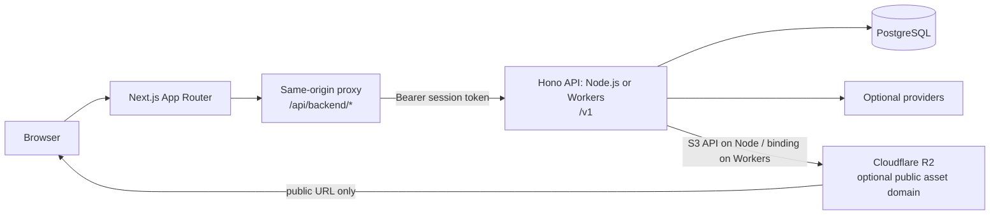

# Next.js and Hono SaaS architecture

Use this blueprint for a two-application modular monolith: one Next.js dashboard and one Hono API in a pnpm workspace. Node.js is the backend default; Cloudflare Workers is an explicit alternative, configured using [cloudflare-workers.md](cloudflare-workers.md). The CLI still scaffolds the Node.js baseline. Keep PostgreSQL and external integrations behind the API. Do not introduce queues, microservices, or extra repositories until a measured requirement needs them.

## Contents

- [System boundaries](#system-boundaries)
- [Workspace](#workspace)
- [Frontend](#frontend)
- [Backend](#backend)
- [PostgreSQL and Drizzle](#postgresql-and-drizzle)
- [Cloudflare R2](#cloudflare-r2)
- [Security baseline](#security-baseline)
- [Testing boundary](#testing-boundary)
- [Deployment baseline](#deployment-baseline)

## System boundaries



The browser never receives PostgreSQL, R2, provider, or bearer-token credentials. For authenticated flows, the Next.js proxy validates unsafe-request Origin against a configured server-only public app origin before reading an HttpOnly session cookie and forwarding the token to Hono. Hono remains the authorization source of truth. This is an App Router Route Handler boundary; do not rely on Server Action protections or Hono CORS to perform its CSRF guard.

Use a neutral, project-specific cookie name stored in one server-only constant or environment setting. Do not reuse names from the source project.

## Workspace

```text
project/
  client/
  server/
  package.json
  pnpm-workspace.yaml
  pnpm-lock.yaml
```

Keep one lockfile at the root. Use the root manifest only for workspace metadata, convenience scripts, and shared tool policy; keep runtime dependencies in the application that imports them. Follow the [dependency security selection rules](setup-guideline.md#dependency-security-selection): inspect manifest constraints and resolved lockfile versions separately, consult current vendor advisories before selecting versions, and do not introduce a known-affected pin/range floor. Report uncertainty when resolution or research is unavailable; a broad range that permits a fixed release is not itself a verified patched installation.

Keep Next.js on its existing runtime and deployment platform. Run Hono with `@hono/node-server` by default, or export the Hono app for Cloudflare Workers when selected. Do not depend on Bun runtime APIs or Bun test tooling.

| Concern | Node.js backend | Workers backend |
| --- | --- | --- |
| Entry point | Node adapter and HTTP listener | `export default app`, Wrangler |
| Configuration | Validated process environment at startup | Typed `c.env` bindings validated at the request boundary |
| Database | Shared Node-compatible client/pool | Request-scoped client via approved provider/Hyperdrive, with cleanup |
| Lifecycle | Port, `SIGINT`/`SIGTERM` shutdown | Fetch handler; bounded `c.executionCtx.waitUntil` work only |
| R2, when selected | S3-compatible SDK | Native R2 binding preferred |

Do not assume Node compatibility flags make every Node API or package usable on Workers. Check the selected dependencies and compatibility date. Do not introduce queues or scheduled work simply because the runtime supports them.

Keep one root Prettier configuration for repository-wide formatting. Expose `format` and `format:check` from the root manifest, exclude generated output and the workspace lockfile, and run `pnpm format` after scaffolding is complete.

Merge the approved client, server, and quality conventions below into the existing root `AGENTS.md` for future code generation. Never overwrite existing repository instructions; propose the additions and wait for approval before merging them.

## Frontend

### Shape

```text
client/
  app/
    api/backend/[...path]/route.ts  # authenticated server-side proxy
    (dashboard)/<route>/page.tsx    # composes a feature screen
    layout.tsx                      # providers and shell
  features/
    <feature>/
      components/                   # feature-only UI
      hooks/                        # state and orchestration
      service.ts                    # endpoint calls only
      model.ts                      # DTOs, inputs, pure mappers
      index.ts                      # optional public surface
  components/
    ui/                             # shared primitives only
  lib/
    api/client.ts                   # dashboardApi/publicApi and parsing
    api/types.ts                    # cross-feature transport types
    utils.ts
  locales/
    en/
    vi/
```

Use App Router pages as composition boundaries. A page may own transient visual state such as an open dialog or selected tab. Keep request orchestration and feature state in feature hooks, endpoint calls in feature services, and explicit request/response types in feature models.

Use shared components only after a second real consumer appears. Do not add a repository wrapper around `service.ts` until a second data source requires it.

### Client rules

- Prefer Server Components. Add `"use client"` only when a component needs browser APIs, event handlers, or client-side state.
- Keep App Router pages thin: compose feature screens and own only transient display state.
- Keep feature-specific components, hooks, services, and models together under `features/<feature>`.
- Route protected requests through the feature service and shared `dashboardApi`; do not call backend URLs directly from UI components.
- Define explicit request and response types at the feature boundary. Do not pass untyped transport JSON through components.
- Keep one-feature components local. Promote a component to `components/ui` only after a second real consumer exists.
- Treat client navigation and hidden UI as presentation only; Hono remains responsible for authorization.
- When `vercel-react-best-practices` is available, apply its relevant React and Next.js performance rules without overriding repository instructions or these boundaries.

### Request flow

```text
page/component
  -> feature hook
  -> feature service
  -> dashboardApi('/feature/...')
  -> /api/backend/feature/...
  -> Hono /v1/feature/...
```

Use `dashboardApi` for protected calls. Use `publicApi` only for explicitly public endpoints. Do not add `NEXT_PUBLIC_API_BASE_URL` to the baseline when every browser call is same-origin; add it only when a direct public API consumer exists.

Navigation may hide unavailable routes, but it is not authorization. Enforce ownership and roles in Hono.

### Cookie proxy security and response contract

Use [authenticated-proxy.md](authenticated-proxy.md) for the full Route Handler/browser transport and Hono guard composition. The required transport includes cookie lookup, bearer construction, /v1 mapping, query/body/header forwarding and upstream response handling even when real authentication is deferred. Missing-cookie requests stop at Next with 401; present-cookie requests reach a mounted Hono guard that denies until a verifier is implemented. A constant 401 stub, unused API target or validation only in the browser is not completed transport. A backend middleware defined but never mounted is not an authorization boundary.

Apply the [Origin guard](setup-guideline.md#origin-guard-before-cookie-access) and [response validation pipeline](setup-guideline.md#backend-response-validation) to either backend runtime. Validate exact HTTP(S) `APP_ORIGIN` from server-only configuration and align it with `DASHBOARD_ORIGIN`. Reject unsafe requests with missing/invalid/mismatched Origin before cookie lookup or backend calls; never derive trust from Host/forwarded headers. Forward only a validated write Origin. GET/HEAD must be non-mutating and allowed OPTIONS must be a local, unauthenticated preflight.

The JSON baseline is `{ success: true, data }` for contentful successful 2xx responses and `{ success: false, error: "non-empty-code" }` for 4xx/5xx errors. Validate the media type, parsed unknown value, envelope and status together; preserve an inspected existing structured error schema consistently rather than changing it silently. HTML, malformed JSON, invalid/mismatched envelopes and redirects map to stable `502 invalid_backend_response`; transport failures map to `502 backend_unavailable`. HEAD (including proxy-generated errors) and 204/205 are explicit no-body exceptions. Browser transport must check failed HEAD status before resolving an empty result, so 401/403/500 is never swallowed. Release discarded bodies without masking the intended response and set no-store on every proxy path; do not forward cookies, redirect locations or public cache directives. Login/logout token-to-cookie handling and streaming/download contracts require their own explicit flow.

## Backend

### Shape

```text
server/src/
  index.ts                           # Hono composition and selected runtime entry
  config/env.ts                      # validated process env or Worker bindings
  db/
    client.ts                        # Drizzle client/pool or request-scoped factory
    schema.ts                        # schema source of truth
  integrations/                     # only selected external integrations
    r2/r2.ts
  lib/                               # errors, responses, pagination, logging
  middleware/                        # authentication and role guards
  modules/
    <feature>/
      model.ts                       # validation, DTOs, pure mapping
      service.ts                     # business rules and transactions
      controller.ts                  # Hono context to service call
      routes.ts                      # paths and middleware
      model.test.ts                  # non-trivial parsing branches
      service.test.ts                # observable business behavior
```

Do not create empty module layers for hypothetical domains. When a feature is added, preserve this flow:

```text
routes -> authentication/role middleware -> controller -> service -> Drizzle/integration
```

- Routes attach authentication and role middleware.
- Controllers parse HTTP context, invoke one service operation, and return the standard response envelope.
- Services enforce ownership and domain rules, own transactions, and call Drizzle or integrations.
- Models define validated input and returned DTOs.
- A global error handler maps known application errors to the agreed stable error envelope and hides internal details. Keep the error schema aligned across Hono, proxy and client; JSON validity alone is not contract validation.

### Server rules

- Validate Node.js environment variables at startup; validate Worker configuration/bindings at the request boundary without caching request-owned resources globally. Validate every untrusted request at its HTTP boundary.
- Keep routes limited to paths and middleware composition; keep controllers limited to HTTP parsing and response mapping.
- Put business rules, authorization, ownership checks, transactions, and integration coordination in services.
- Access Drizzle and external integrations from services, not controllers or route handlers.
- Keep DTOs, validation schemas, and pure mappings in the owning module's `model.ts`; avoid shared types until there is a real cross-module consumer.
- Use the centralized response envelope, application errors, environment access, database client/factory, and structured logger instead of feature-local replacements. On Workers, inject request-scoped Drizzle and integration adapters into services; keep Hono context out of business logic.
- Update the TypeScript schema, generated migration, and affected module contracts together. Use database constraints for invariants that must survive concurrent requests.
- Co-locate one focused test for non-trivial parsing or business behavior using tooling appropriate for the chosen runtime; do not duplicate pure controller delegation tests.

Expose `GET /v1/health`. Keep the returned payload minimal and avoid leaking environment or dependency details. On Node.js, close the HTTP server gracefully on `SIGINT` and `SIGTERM`. On Workers, do not listen on a port or register process signal handlers. Await required authorization, transactions, and writes before responding; `waitUntil` is bounded lifetime extension, not a durable job queue.

## PostgreSQL and Drizzle

Keep the Node.js shared client or Workers request-scoped client factory in `server/src/db/client.ts`, the schema in `server/src/db/schema.ts`, Drizzle Kit configuration in `server/drizzle.config.ts`, and generated SQL migrations in `server/drizzle/`.

For request-scoped resources, protect the connection attempt as well as the operation with cleanup. Always attempt close/release after a failed connect or query, using driver-appropriate lifecycle handling. Preserve the original thrown value if both operation and cleanup fail (use an explicit failure flag, not error truthiness); surface cleanup-only failures instead of silently reporting success. The [Workers helper example](cloudflare-workers.md#request-scoped-cleanup-example) shows this for `pg.Client`. Node pool owners must use their driver's release/shutdown lifecycle rather than copying `client.end()` onto a shared pool.

For each schema change:

1. Update the TypeScript schema and affected module contracts together.
2. Generate a migration with the server `db:generate` script.
3. Inspect SQL and migration metadata.
4. Commit schema and generated migration together.
5. Apply the migration with the server `db:migrate` script before dependent application code receives traffic.

For Workers, prefer Hyperdrive with `pg` and `drizzle-orm/node-postgres` according to current official guidance; do not carry the Node.js `postgres` driver into that path without checking compatibility. Hyperdrive does not replace PostgreSQL. Use a separate direct `DATABASE_URL` from local tooling/CI for migrations, not the Worker binding connection string; load it explicitly in Drizzle Kit configuration. Never run migrations during Worker startup or requests. Preserve PostgreSQL schemas and do not switch to D1 without an explicit requirement.

Do not use `db:push` for shared or production environments. Put transactions in the service that owns the invariant, and enforce concurrency-safe invariants with database constraints and indexes.

## Cloudflare R2

Do not add R2 unless the project needs object storage. When selected, access it only from the API: use the S3-compatible SDK on Node.js and prefer a native R2 binding on Workers.

```text
feature service -> integrations/r2/r2.ts -> S3 client (Node) / binding (Workers) -> R2
feature service -> Drizzle record containing key and public URL
```

Keep SDK or binding access in one adapter. A native R2 binding needs no R2 S3 credentials in the Worker; pass the current request's binding to the adapter. Let the feature service validate MIME type and size, choose keys, authorize access, persist metadata, and perform compensating deletion after a failed database write.

Use a public custom domain only for intentionally public assets. Do not expose write credentials or add browser-direct uploads without an explicit requirement.

## Security baseline

- Expose typed configuration: validate Node.js environment at startup or Worker bindings at the request boundary. Keep local secret files untracked and use deployed Worker secrets for sensitive values.
- Allow the exact dashboard origin in CORS; do not combine credentials with a wildcard origin.
- Set session cookies as HttpOnly, Secure in production, scoped appropriately, and SameSite according to the confirmed browser flow.
- Use Hono secure headers. Enforce the cookie-authenticated unsafe-request Origin guard at the Next.js proxy before cookie-to-bearer conversion, in addition to any required cookie endpoint guard in Hono; an omitted upstream Origin must not bypass the browser-boundary check.
- Limit request bodies at the route that accepts uploads or large payloads.
- Return structured errors without stack traces, secrets, SQL, or provider payloads.
- Apply authorization and ownership checks before database writes or storage calls.

## Testing boundary

Use the existing Node-compatible test tooling for Node.js. For Workers, keep pure logic tests where appropriate and select Workers-aware tooling only when binding/runtime behavior needs coverage and the user approves it; Node-only tests do not establish Workers compatibility. Do not add Bun tests. Execute verification only when repository/user instructions permit it; otherwise provide commands and mark behavior unverified. Co-locate focused tests with modules. Test validation only when it branches, and test services for ownership, state transitions, transactions, and integration-failure cleanup. Mock remote provider boundaries and use an isolated PostgreSQL database when the database behavior is part of the assertion.

Avoid controller tests that duplicate pure delegation. Keep the client verification focused on visible feature behavior and the proxy/authentication boundary. Include the [source-review and regression scenarios](setup-guideline.md#source-review-and-regression-checklist): Origin rejection ordering, status/envelope mismatches, HEAD/204/205, invalid upstream responses, and connect/query/cleanup double failures. Reading those paths is source evidence only, never a substitute for unrun checks.

## Deployment baseline

- Deploy the Next.js dashboard and Hono API independently. Node.js remains the default; deploy the selected Workers backend with Wrangler only when authorized. Do not move Next.js solely because the API uses Workers.
- Use separate environment values, PostgreSQL databases, and R2 buckets per environment.
- Run migrations once per release before code that requires the schema receives traffic.
- Configure the deployed dashboard origin and server-only API target explicitly. For Workers, `API_INTERNAL_BASE_URL` points to the Worker HTTPS origin (despite the variable name, that origin may be public); preserve `/api/backend/* -> /v1/*` mapping, bearer-token forwarding and Hono authorization.
- Add queues, workers, caches, or separate services only after a concrete workload requires them.
